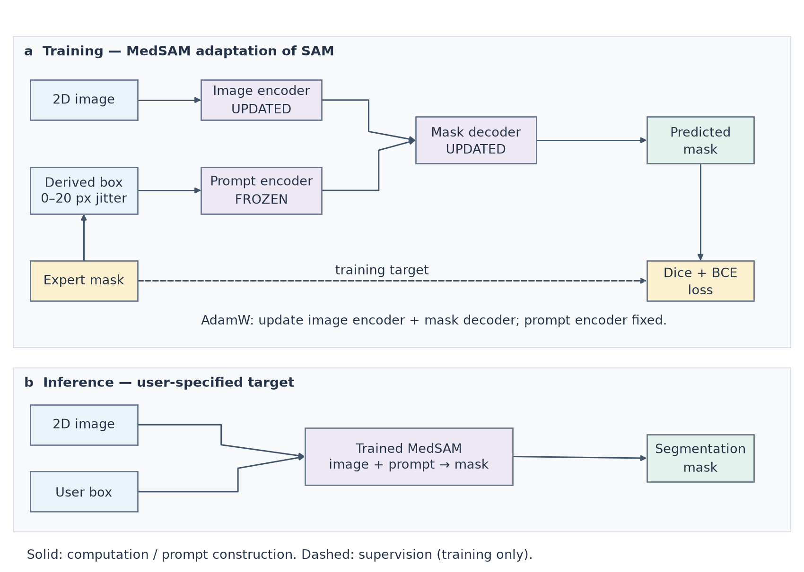

# 医学 × 计算机／医工交叉科研绘图

medical-computing-figures helps an AI assistant create, revise and audit editable scientific figures from the current study’s evidence.

用于医学 AI、模型架构、RAG／GraphRAG、多模态／组学方法及医工系统的图文核验和绘图，也支持真实汇总数据的可复现结果图。

## 使用

将此完整目录作为一个技能安装到宿主支持的个人技能目录，目录名使用 `medical-computing-figures`，避免启用两个同名副本。入口是 [SKILL.md](SKILL.md)，详细能力与限制见 [STATUS.md](STATUS.md)。

- 绘图：用 medical-computing-figures 根据我的方法材料绘制可编辑模型图。
- 审图：核对这张 RAG 图与正文的关系，先不要修改图稿。
- 学习：学习指定公开论文，更新规则并执行迁移测试。

普通绘图不会自动启动持续扩库；缺失的科学事实、实验数值和临床结论不会由参考论文补齐。

## 安装与其他智能软件

本技能采用 [Agent Skills 目录格式](https://agentskills.io/specification)，核心绘图和检查脚本不调用特定模型 API。宿主需要文件读写、Python 执行以及实际查看图片／PDF 页面的能力。仅能文字对话的软件可以参考说明，但不能据此声称已经完成图稿导出或视觉核对。

| 宿主 | 安装与调用 | 验证范围 |
| --- | --- | --- |
| Codex | 请 `$skill-installer` 从本仓库安装；也可将完整目录放入 `~/.agents/skills/medical-computing-figures/`。使用 `$medical-computing-figures` 调用。见 [官方说明](https://learn.chatgpt.com/docs/build-skills)。 | 原始 1.44.1 版本已在开发者本机 Codex 验收；公开精简版的额外检查另列。 |
| Claude Code | 将完整目录放入 `~/.claude/skills/medical-computing-figures/`，使用 `/medical-computing-figures` 调用。见 [官方说明](https://code.claude.com/docs/en/skills#choose-where-skills-load)。 | 已核对官方格式和安装方式，尚未进行本技能的宿主实测。 |
| Gemini CLI | 执行下方安装命令，再用 `/skills list` 检查是否发现；必要时 `/skills reload`。见 [官方说明](https://geminicli.com/docs/cli/using-agent-skills/)。 | 已核对官方格式和安装方式，尚未进行本技能的宿主实测。 |

    gemini skills install https://github.com/lmlmlllm/medical-computing-figures

安装方式按 2026-10-23 官方文档核对；宿主版本和组织设置可能影响技能发现。选择一种安装位置即可。仓库中的 `agents/openai.yaml` 是 Codex 的可选显示和调用元数据，不是核心脚本的运行依赖。

运行脚本前，在宿主使用的 Python 环境中安装 [requirements.txt](requirements.txt) 所列依赖。建议使用独立虚拟环境，并让宿主使用该环境的 Python：

    python -m pip install -r requirements.txt

## 运行示例

从技能目录执行，并为输出选择新目录：

    python scripts/check_spec.py examples/medsam/figure_spec.json
    python scripts/render.py examples/medsam/figure_spec.json --out YOUR_NEW_OUTPUT
    python scripts/plot_results.py examples/results/data.csv --mapping examples/results/mapping.json --out YOUR_NEW_PLOT

[SVG 图源](examples/medsam/baseline/figure.svg) · [完整图注](examples/medsam/baseline/caption.md)

## 公开源码版范围

本目录由已在原开发主机验收的 1.44.1 版本整理。技能入口、5 个当前绘图／检查脚本、样式与示例输入保持原字节；参考指导和 89 条案例卡保留，历史本机路径替换为占位符。历史来源哈希只描述原证据，不是对脱敏文本的当前哈希声明。

此源码版包含少量可直接执行示例，不包含 6,000 余份开发测试历史、原始宿主会话、内部评分答案、旧打包器、8 个历史流程 ZIP、运行环境或第三方论文原文／原图。参考笔记中提及但未随包提供的审计路径属于历史证据位置，不能当作可运行输入。它不等同于原始 248 MB 本机归档包。

原版本本机验收包含 54 项核心检查、4 个最新流程包重放、原生与实际图像查看及真实宿主调用；这些是原版的有界证据，不代表本源码版已通过跨平台、期刊或专家验收。公开版本的额外检查在 [发布说明](RELEASE.md) 中单列。

## 来源与许可

本项目维护者拥有权利的原创代码、说明、规格与独立绘制图稿采用 [MIT 许可](LICENSE)，允许依照许可使用、修改和再分发，包括商业使用。复制或再分发相关内容时须保留版权和许可声明。

论文事实、来源标识、第三方汇总指标及相关权利不因本项目的 MIT 许可而重新授权。本仓库不分发论文原文、原图、数据集原件或字体文件；来源定位保留在案例卡和目录中。真实结果示例是有明确来源的公开汇总值转录，不能当作原模型实验复现。具体范围见 [NOTICE.md](NOTICE.md)。
